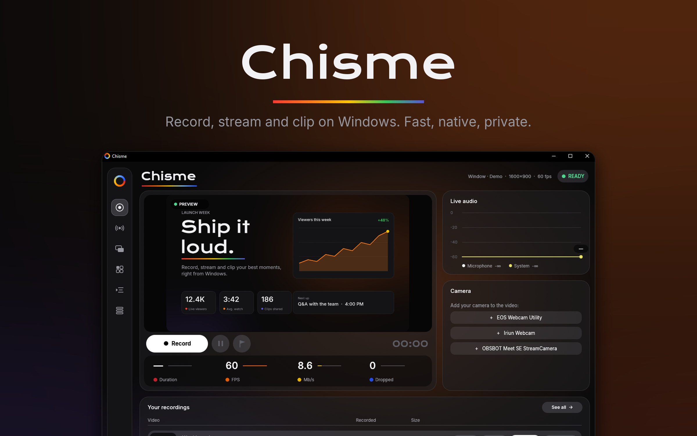
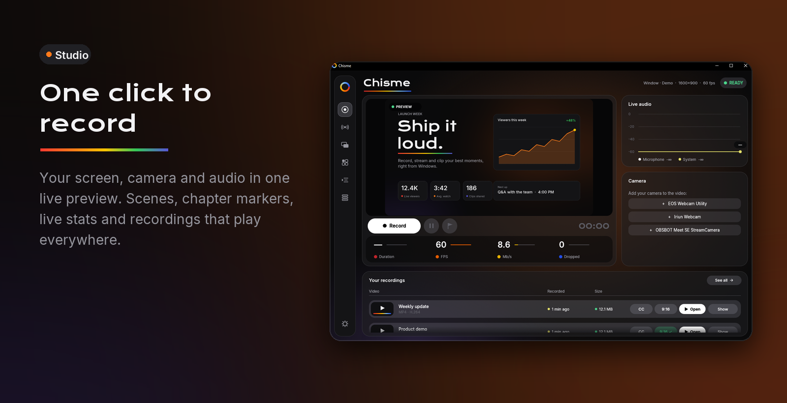
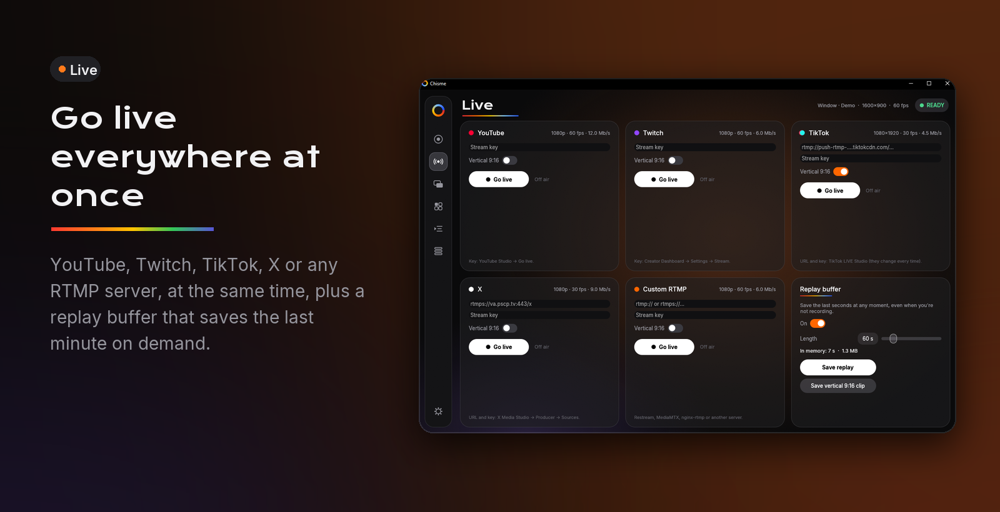
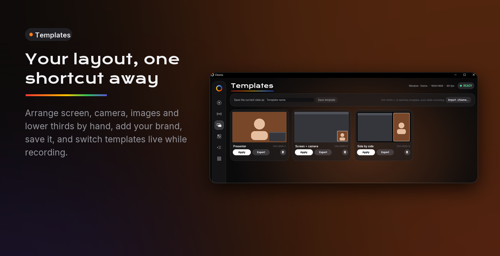
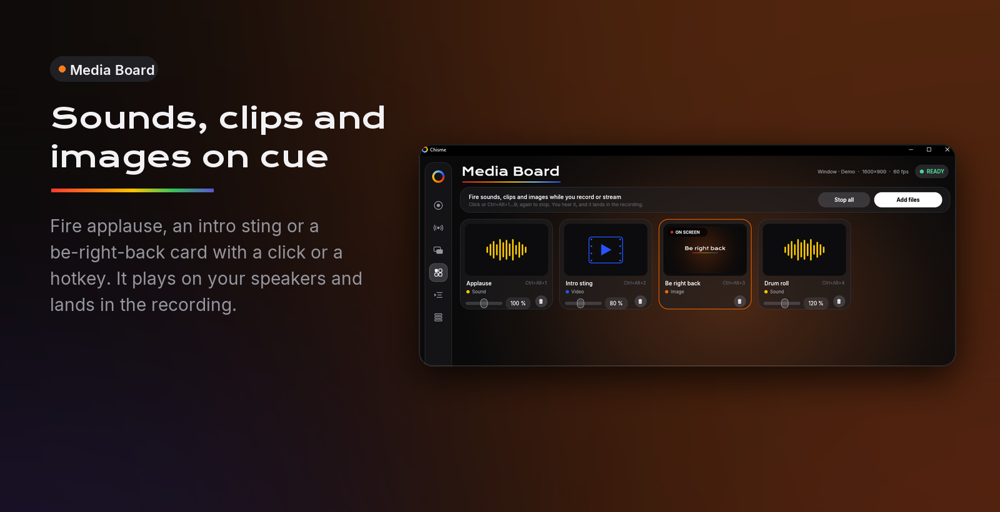
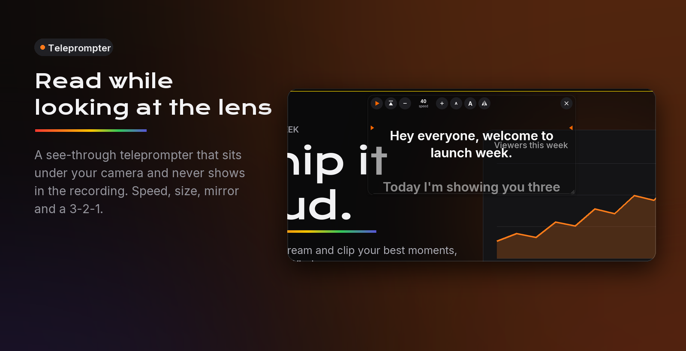
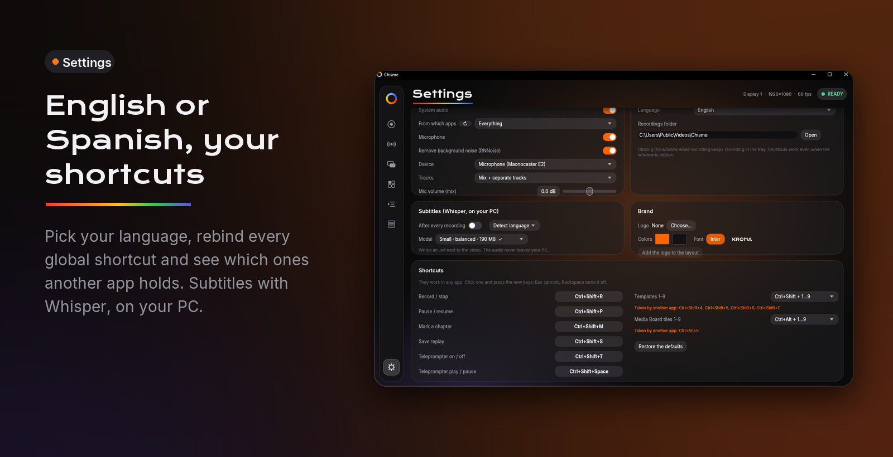

<p align="center">
  
</p>

<p align="center">
  <a href="https://github.com/LordVayron/chisme/releases/latest"></a>
  
  
  <a href="#license"></a>
  <a href="https://github.com/LordVayron/chisme/actions/workflows/ci.yml"></a>
</p>

**Chisme** is a screen recorder, live-streaming studio and clip maker for Windows, created by
**Jorge ([@LordVayron](https://github.com/LordVayron))** and **079 AI Labs**. It's native
(Rust, Direct3D, Media Foundation), so recording starts the instant you press the button and
video never leaves the GPU. Everything runs on your PC: no account, no telemetry. The one
exception is guests, who connect through your own LiveKit Cloud project.

<p align="center">
  <a href="https://chisme-ten.vercel.app"><b>Website</b></a> ·
  <a href="https://github.com/LordVayron/chisme/releases/latest"><b>Download for Windows</b></a> ·
  <a href="docs/GUIDE.md">Technical guide</a> ·
  <a href="CHANGELOG.md">What's new</a>
</p>

---













## Features

**Record**
- Your screen or one window, system audio, microphone and webcam into one MP4 (H.264 or HEVC).
- Your GPU's hardware encoder (NVENC, AMF, Quick Sync) and a true constant frame rate.
- Pause and resume without gaps. Audio and video stay in sync to the millisecond.
- Separate tracks for the mix, system audio and microphone, ready for editing.
- Per-app audio: one app's sound, or everything except it.
- RNNoise removes fans, hum and keyboard noise from your mic.
- Chapter markers while you record, saved in YouTube's chapter format.

**Compose**
- Five scenes, or your own layout. Drag screens, cameras, images and lower thirds wherever you
  want them.
- Camera shapes (circle, rounded, square, pill, squircle), borders, shadows and mirroring.
- **Virtual background:** blur your room or put your own picture behind you, no green screen. An
  AI model runs on your PC.
- Brand kit: logo, colors and font. Save layouts as templates, share them as `.chisme` files and
  switch between them live.

**Go live**
- YouTube, Twitch, TikTok, Instagram, X and any RTMP(S) server, all at once, each with its own
  encode (vertical 1080×1920 for TikTok and Instagram while YouTube gets 1080p60).
- Replay buffer: save the last 15 seconds to 5 minutes whenever something great happens.
- Stream keys stay in Windows Credential Manager.

**Guests**
- Send a link. Guests join from their browser (nothing to install), set up camera and mic, and
  wait in a green room until you bring them on stage.
- Up to four on stage, placed by the Interview, Panel, Guest full screen and Screen + guests
  scenes, or by a "+ Guest" layer in any scene. Mute or remove anyone.
- Runs on your own LiveKit Cloud project (free tier). Chisme signs the invite links itself.

**Present**
- **Teleprompter:** a see-through script under your camera that never shows in the recording.
- **Media Board:** fire sounds, clips and images with a click or a hotkey. They land in the
  recording and the stream. 18 studio sound effects come included.

**Finish**
- Automatic subtitles (`.srt`) with Whisper, transcribed on your PC.
- A vertical 1080×1920 copy of any recording for TikTok, Reels and Shorts.

**Your way**
- English or Spanish.
- Every global shortcut can be changed.
- A full command line for scripting (`chisme record --help`).

## Install

1. Download `Chisme-Setup-<version>.exe` from the
   [latest release](https://github.com/LordVayron/chisme/releases/latest).
2. Run it. It installs for your user only, so it needs no admin rights.

Windows SmartScreen may warn you the first time, because the installer isn't code-signed yet.
Choose **More info → Run anyway**.

**Requirements:**
- Windows 10 version 2004 or later, or Windows 11, 64-bit.
- A GPU with Direct3D 12. Any GPU from the last ~8 years works.

## Quick start

| | Default shortcut |
|---|---|
| Record / stop | `Ctrl+Shift+R` |
| Pause / resume | `Ctrl+Shift+P` |
| Mark a chapter | `Ctrl+Shift+M` |
| Save replay | `Ctrl+Shift+S` |
| Teleprompter on / off, play / pause | `Ctrl+Shift+T`, `Ctrl+Shift+Space` |
| Templates 1–9 | `Ctrl+Shift+1…9` |
| Media Board tiles 1–9 | `Ctrl+Alt+1…9` |

They work even when Chisme is hidden in the tray. You can change them in Settings → Shortcuts.

From a terminal:

```powershell
chisme record --cam --bg-blur          # screen + webcam with a blurred background
chisme record --window "Chrome" -t 60  # one window for 60 seconds
chisme record --stream youtube --replay 60
chisme subtitles "My video.mp4"
chisme vertical "My video.mp4"
```

The [technical guide](docs/GUIDE.md) covers every option and how each part works.

## Privacy

- **Everything stays on your PC.** Recordings, subtitles (Whisper) and the virtual background
  (MediaPipe) are all processed locally.
- **No telemetry, no account.**
- **The internet is used only when you ask for it:** to stream, to host guests (through your
  LiveKit project), and to download a Whisper model the first time you make subtitles. That model comes from Hugging Face and is checked against a
  pinned SHA-256.
- **Stream keys** and your LiveKit API secret are stored in Windows Credential Manager, never in
  plain text.
- **Chisme's own windows never show up in a recording**, the teleprompter included.

See [SECURITY.md](SECURITY.md) to report a vulnerability.

## Building from source

You need:
- [Rust](https://rustup.rs) (stable, 2024 edition).
- The Visual Studio Build Tools with the C++ workload.
- [CMake](https://cmake.org) and [LLVM](https://llvm.org) (`winget install Kitware.CMake LLVM.LLVM`). whisper.cpp needs them.
- [Inno Setup 6](https://jrsoftware.org/isinfo.php), only to make the installer.

```powershell
git clone https://github.com/LordVayron/chisme
cd chisme
cargo build --release      # target\release\chisme-app.exe and chisme.exe
cargo test
powershell -ExecutionPolicy Bypass -File scripts\package.ps1   # dist\Chisme-Setup-<version>.exe
```

If CMake or LLVM live somewhere unusual, set `CMAKE` and `LIBCLANG_PATH`.
`.cargo/config.toml` turns on AVX2 for whisper.cpp (without it, subtitles are ~20× slower) and
links the C runtime statically (`+crt-static`, `/MT`), which LiveKit's WebRTC library requires.

## How it's built

| Part | Technology |
|---|---|
| Capture | Windows.Graphics.Capture, WASAPI (loopback, process loopback, microphone), Media Foundation (webcam) |
| Compositing | Direct3D 11: the video processor plus HLSL shaders for shapes, layers and the virtual background |
| Encoding | Media Foundation: hardware H.264/HEVC and AAC; MP4 sink writer and async MFT for streaming |
| Streaming | Its own RTMP/RTMPS client (FLV, AMF0), TLS through SChannel |
| Guests | [LiveKit](https://livekit.io) Rust SDK (WebRTC) in the app; a static green room page (`docs/join/`) using livekit-client |
| AI | MediaPipe Selfie Segmentation run with [tract](https://github.com/sonos/tract); [whisper.cpp](https://github.com/ggerganov/whisper.cpp) via whisper-rs |
| App | [egui](https://github.com/emilk/egui) on wgpu (Direct3D 12 + DirectComposition), tray icon, global hotkeys |

The source map:

```
src/
  engine.rs     one capture session: preview, recording, streams, replay, Media Board
  mixer.rs      audio mixing on the video clock, resampling, limiter, RNNoise
  layout.rs     custom layouts (layers)        templates.rs  .chisme templates
  live/         RTMP client, encoders, replay ring
  segment.rs    person segmentation            vbg.rs        virtual background worker
  media.rs      Media Board decoding + monitor subtitles.rs  Whisper
  guests.rs     LiveKit room, invite links, guest video and audio
  win/          Windows APIs: capture, audio, camera, encoders, shaders
  app/          the interface (egui): studio, live, templates, guests, media, script, settings
docs/
  index.html    the website (deployed on Vercel)
  join/         the guests' green room (GitHub Pages)
assets/sounds/  the built-in sound effects
```

## Credits

Chisme is designed and built by **Jorge ([@LordVayron](https://github.com/LordVayron))** and
**079 AI Labs**.

### Acknowledgements

Chisme stands on great open-source work:

- **[MediaPipe Selfie Segmentation](https://huggingface.co/onnx-community/mediapipe_selfie_segmentation)**
  by Google (Apache-2.0).
- **[whisper.cpp](https://github.com/ggerganov/whisper.cpp)** and the Whisper models by OpenAI (MIT).
- **[RNNoise](https://github.com/xiph/rnnoise)**, through [nnnoiseless](https://github.com/jneem/nnnoiseless).
- **[LiveKit](https://livekit.io)** SDKs (Apache-2.0) for guests.
- The fonts **Inter** (Rasmus Andersson) and **Krona One** (Sorkin Type), under the SIL Open Font
  License.

See [NOTICE.md](NOTICE.md) for the full attributions.

## Contributing

Bug reports, ideas and pull requests are welcome. See [CONTRIBUTING.md](CONTRIBUTING.md).

## License

Copyright © 2026 Jorge (LordVayron) and 079 AI Labs. Dual-licensed under either of
[MIT](LICENSE-MIT) or [Apache-2.0](LICENSE-APACHE), at your option.
